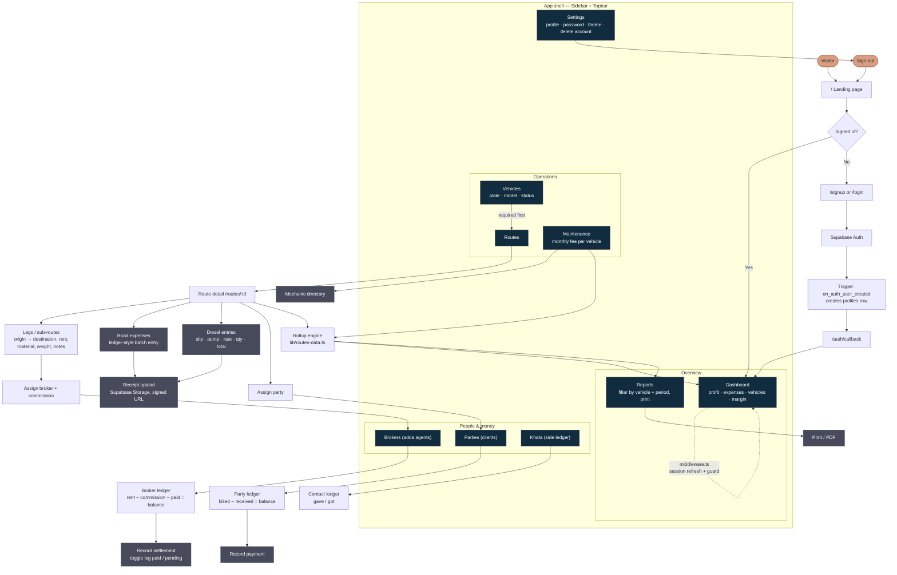
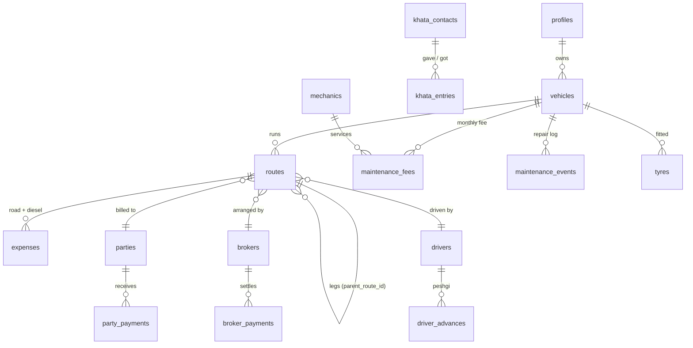

# HiFiGoods — UX Audit & Roadmap

_Scanned 28 Jul 2026 · Next.js 15 · React 19 · Tailwind v4 · Supabase_

> **Status: P0, P1 and P2 are all implemented.** See `IMPLEMENTATION.md` for
> what changed, what still needs running locally, and what remains.

Modules live today: Dashboard, Reports, Vehicles, Routes (+legs, diesel, receipts), Maintenance, Parties, Brokers, Khata, Settings, Auth, Landing.

---

## P0 — Broken / blocking

### 0. Migration 09 was never applied to the live database

Verified directly against the live project (`hunrfdmwfgdvhkszosog` / **HiFiGoodsV3**, the ref in `.env.local`). Migrations 01–08 are all present. **Migration 09 is not.** Missing from the live DB:

- `routes.material`, `routes.weight`, `routes.notes` — **0 of 3 columns exist**
- `broker_payments.route_id` — **does not exist**
- `maintenance_events` table — **does not exist**

The app code already reads and writes all three. So `todos.md` items **7 (leg material/weight/notes)** and **8 (broker paid/pending toggle)** are written in the UI but will fail at runtime against this database. Run `supabase/migration_09.sql` in the SQL editor.

Related: **1 auth user has no `profiles` row.** The `on_auth_user_created` trigger exists, so this account predates it — exactly what migration 04's backfill was written to repair. Re-run the backfill block.

### 0b. Every RLS policy re-evaluates `auth.uid()` per row

**63 policies** across all 16 tables call `auth.uid()` bare instead of `(select auth.uid())`. Postgres can't hoist the call out of the row loop, so it re-executes for every single row scanned. Harmless at 22 expenses; a visible stall at 20,000. This is the single highest-value database change you can make and it's a mechanical find-and-replace.

```sql
-- pattern for each policy
using ( (select auth.uid()) = user_id )
```

Also flagged by the security advisor, worth fixing in the same pass:

- `handle_updated_at` has a mutable `search_path`
- `handle_new_user()` is `SECURITY DEFINER` and callable by **anon** via `/rest/v1/rpc/` — revoke EXECUTE
- `delete_current_user()` is `SECURITY DEFINER` and callable by any signed-in user — it's meant to be, but confirm that's intentional
- The public `avatars` bucket has a broad SELECT policy allowing clients to **list every file** in it
- Leaked-password protection (HaveIBeenPwned) is disabled in Auth settings — one toggle

### 1. TypeScript is fully broken (92 errors)

`npx tsc --noEmit` fails everywhere with `type 'never'`. Cause: `@supabase/supabase-js` resolved to **2.110.0** (package.json pins `^2.47.10`), and modern supabase-js requires the `Database` type to carry `__InternalSupabase: { PostgrestVersion }` plus `Views` / `Functions` / `Enums` / `CompositeTypes`. The hand-written `lib/database.types.ts` has none of these, so the generic constraint silently fails and every query result collapses to `never`.

Symptoms this hides from you right now: every insert/update payload is unchecked, `.select()` results are untyped, column renames won't be caught.

**Fix:** regenerate types from the live project (`supabase gen types typescript`), pin the supabase-js minor, and add `typecheck` to a pre-commit/CI step. This is a 30-minute fix that restores your entire safety net.

`lib/supabase/server.ts` and `middleware.ts` additionally have implicit-`any` cookie params — same root cause.

### 2. No error or not-found boundaries

There is not a single `error.tsx`, `global-error.tsx`, or `not-found.tsx` in `app/`. Every `loading.tsx` exists, but no failure counterpart. If Supabase hiccups mid-fetch, or someone opens `/routes/<deleted-id>`, the user gets a white screen or an unstyled Next.js crash page — no retry, no way back.

**Fix:** one `app/(app)/error.tsx` with a "Try again" reset button, one `not-found.tsx`, one `global-error.tsx`. ~40 lines total, disproportionate UX payoff.

### 3. Destructive deletes with no confirmation

`parties-view.tsx`, `brokers-view.tsx`, `khata-view.tsx` call `deleteParty` / `deleteBroker` / `deleteKhataContact` directly from a trash icon — one misclick and a whole ledger with months of payment history is gone.

Routes and Vehicles *do* have confirm dialogs (`route-card.tsx`, `delete-vehicle-dialog.tsx`). Ledger deletes are the more dangerous ones and they're the unprotected ones.

**Fix:** extract the confirm dialog from `route-card.tsx` into a shared `<ConfirmDialog>` and apply it everywhere. Bonus: for parties/brokers with history, offer **Archive** instead of delete.

### 4. Shared `isDeleting` state across rows

In the parties/brokers/khata tables, one `useTransition` is shared by every row, so deleting party #3 puts a spinner on **all** delete buttons and disables the whole column. Track the pending id instead.

---

## P1 — Daily friction

### 5. No search, no filter, no sort, anywhere

Not one page reads `searchParams`. Once a real operator has 40 vehicles, 300 routes and 80 parties, every screen becomes a scroll-and-squint exercise. `cmdk` is already a dependency but only powers the Combobox.

**Fix, in order of payoff:**
- Search box on Routes / Parties / Brokers / Khata / Vehicles (URL-backed `?q=`, so it survives refresh and is shareable)
- Date-range and vehicle filter on Routes
- Sortable columns on the ledger tables (balance desc is the one everyone wants)
- `⌘K` global command palette — jump to any party, broker, vehicle, or route by name

### 6. Everything loads everything

`getRoutesWithExpenses()` and `getRoutesDetailed()` pull **all** routes with **all** nested expenses on every dashboard/routes render, with `dynamic = "force-dynamic"` so nothing is cached. At 500 routes × 15 expenses that's a slow, heavy payload on a Pakistani mobile connection.

**Fix:** pagination or infinite scroll on Routes; push aggregation into Postgres views/RPC for the dashboard instead of summing in JS; keep force-dynamic but add `revalidateTag` where possible.

### 7. Tables are hostile on mobile

`components/ui/table.tsx` wraps in `overflow-x-auto`. Brokers has **7 columns**. On a phone the user horizontally scrolls to find the balance — and there is no visual affordance that more columns exist. This is a field app; the phone is the primary device.

**Fix:** below `sm`, render each row as a card (name + balance prominent, rest secondary). Same treatment for parties, khata, vehicles.

### 8. Reports are print-only, with 4 fixed periods

`window.print()` is the only export, and periods are locked to This Week / This Month / This Year / All Time. Real needs: "15 Mar – 10 Apr", a specific party's statement, a specific broker's settlement sheet.

**Fix:** custom date range picker; CSV export; per-party and per-broker PDF statement (you already have the receipt/PDF plumbing).

### 9. Dashboard doesn't answer the urgent questions

Current cards: Profit, Expenses, Active Vehicles, Margin — all historical. What an operator actually opens the app to find out:
- Who owes me money right now, and who's overdue
- Which vehicles are idle today
- What did I spend on diesel this month vs last
- Which trips are still running

**Fix:** add a "Needs attention" strip — top 5 outstanding party balances, unpaid broker legs, vehicles idle > N days, routes with no `end_date`.

### 10. No global "Add" affordance

Adding a route means: navigate to Routes → click Add. Every entity is buried one navigation deep. A persistent FAB on mobile / `+ New` in the topbar with a menu (Route, Expense, Payment, Party) removes a step from the most repeated action in the app.

---

## P2 — Polish & trust

| # | Finding | Why it matters |
|---|---|---|
| 11 | No `public/` folder — no favicon, no app icon, no OG image | Tab is blank; shared links look broken; can't be added to a home screen well |
| 12 | No PWA manifest / service worker | Drivers lose signal on the GT Road. Offline-capable expense entry with sync-on-reconnect is the single biggest field win available |
| 13 | English only | Your users are Pakistani transporters. Urdu labels (or at least Urdu-friendly terms: کھاتہ, کرایہ, پیشگی) would meaningfully widen who can use this unaided |
| 14 | Amount inputs are raw `type=number` | No thousand separators while typing — "150000" is easy to misread as 15,000. Format on blur, show a live "1,50,000" hint |
| 15 | `formatDate` uses `en-US`, currency uses `en-PK` | Inconsistent. Pick `en-PK` / `en-GB` day-first formatting throughout |
| 16 | Dates are plain `<input type="date">` | No calendar picker, no "Today / Yesterday" quick-set, no relative labels ("3 days ago") |
| 17 | No undo on any action | Sonner supports action toasts. "Expense deleted · Undo" for 5s prevents most support requests |
| 18 | No optimistic UI | Every mutation is a full server round-trip + `revalidatePath`. `useOptimistic` on payment/expense rows would make the app feel instant |
| 19 | No empty-state guidance on first login | Dashboard with zero data shows PKR 0 cards. A 3-step onboarding checklist (Add vehicle → Add route → Log expense) converts far better |
| 20 | Receipt images have no lightbox | Signed URL opens raw. A modal preview with zoom is expected |
| 21 | No skip-to-content link; sidebar traps focus loosely on mobile | The mobile drawer is a hand-rolled `div role=dialog` — no focus trap, no Escape handler |
| 22 | `next lint` script is deprecated in Next 15 | Lint isn't actually running. Migrate to ESLint flat config |
| 23 | Two disabled nav items (`/tyres`, `/drivers`) commented out in `lib/nav.ts` | Schema for both already exists (migration 05). Half-built features |
| 24 | Dead code in `batch-expense-form.tsx` | `presetRows()` sets a `description` field that isn't on the `Row` interface — a leftover the broken typecheck is hiding |

---

## What to build next

### Sprint 1 — Stop the bleeding (2–3 days)
1. Regenerate `database.types.ts`, pin supabase-js, get `tsc --noEmit` to zero
2. `error.tsx` + `not-found.tsx` + `global-error.tsx`
3. Shared `<ConfirmDialog>` on every destructive action; fix per-row pending state
4. `public/` assets: favicon, app icon, OG image
5. Delete dead code, fix `next lint`

### Sprint 2 — Make it usable at scale (1 week)
6. URL-backed search on all list pages
7. Date-range + vehicle filter on Routes; pagination
8. Mobile card layout for all tables
9. "Needs attention" dashboard strip
10. Global `+ New` / FAB

### Sprint 3 — Make it feel fast (1 week)
11. Optimistic updates on expense, payment, and status-toggle rows
12. Undo toasts on delete
13. Amount input formatting + date picker component
14. Receipt lightbox
15. First-run onboarding checklist

### Sprint 4 — Finish the domain (1–2 weeks)
16. **Drivers** — schema exists; salary, peshgi (advances), per-trip assignment, settlement
17. **Tyres** — schema exists; per-vehicle lifecycle, km life, rotation and replacement alerts
18. Custom date range + CSV export + per-party/per-broker PDF statement
19. Vehicle document expiry tracker (route permit, token tax, fitness, insurance) with reminders

### Sprint 5 — Field-grade (2+ weeks)
20. PWA: installable, offline expense/diesel entry, background sync
21. Urdu localization (next-intl)
22. WhatsApp share — send a party their statement as an image/PDF in one tap (highest-leverage feature for this market)
23. Multi-user: staff accounts with roles (owner / munshi / driver) — RLS is already user-scoped, so this needs an org layer

---

## Website flowchart

Paste this into any Mermaid renderer (GitHub, Notion, Obsidian, mermaid.live):



### Data model, at a glance



---

## Your `todos.md` — status

| Item | Status |
|---|---|
| 1. Diesel as separate category with slip/date/rate/qty/total | Done — migration 06, `diesel-entry-form.tsx` |
| 2. Multiple diesel fills per route | Done |
| 3. Receipt upload on every field | Done for expenses + diesel (`receipt_url`, signed URLs) |
| 4. No receipt on road-level; notes hidden by default | Done — `batch-expense-form.tsx` |
| 5. Table-form input with pre-labelled rows | Done — presets from `ROAD_EXPENSE`, extra rows addable |
| 6. Monthly maintenance fee | Done — migration 06/08, `maintenance-view.tsx` |
| 7. Leg material / weight / notes | ⚠️ **Code done, DB missing** — migration 09 not applied |
| 8. Broker paid/pending toggle in table | ⚠️ **Code done, DB missing** — `broker_payments.route_id` absent |

Six shipped end-to-end. Items 7 and 8 are built in the UI but will error against the live database until `migration_09.sql` is run.

---

## Live database snapshot

Project **HiFiGoodsV3** (`hunrfdmwfgdvhkszosog`, ap-south-1, Postgres 17) — the ref in `.env.local`.

| | |
|---|---|
| Tables | 16 of 17 expected (`maintenance_events` missing) |
| RLS | Enabled on all 16 ✓ |
| Migrations applied | 01–08 ✓ · **09 ✗** |
| Row counts | 1 user · 1 vehicle · 9 routes · 22 expenses · 3 brokers · 1 party · 2 khata entries · 2 maintenance fees |
| Security advisories | 6 warnings |
| Performance advisories | 63 × RLS init-plan · 32 × unused index (expected at this data volume — ignore) |

Note there are three HiFiGoods projects in the org — `HiFiGoods`, `HiFiGoodsV2` (both INACTIVE) and `HiFiGoodsV3` (active, in use). Worth deleting the dead two before they cause a wrong-`.env` incident.
